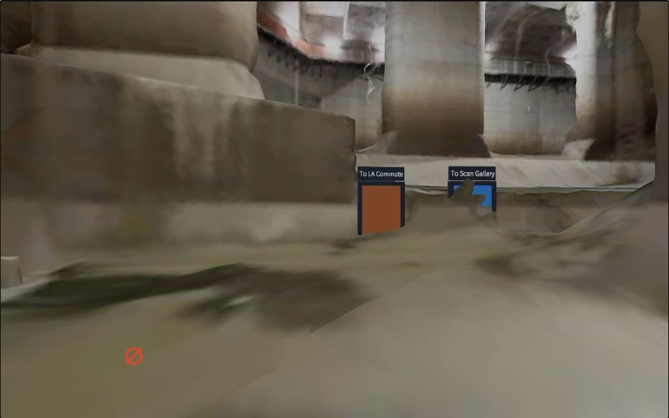
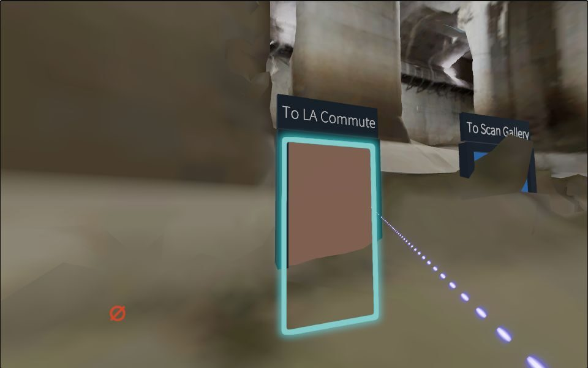
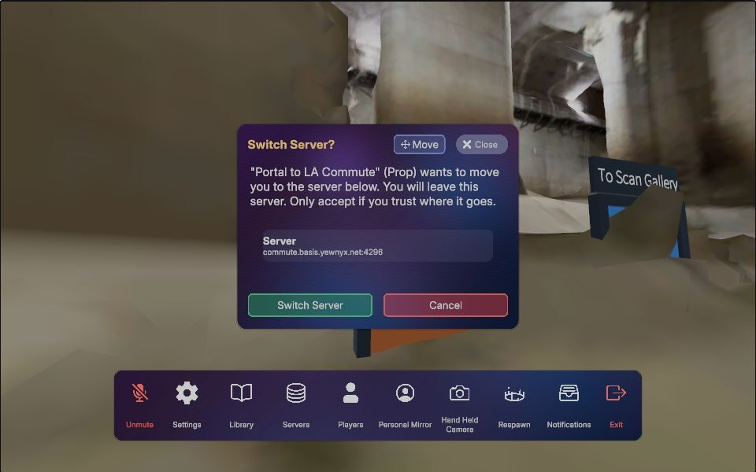
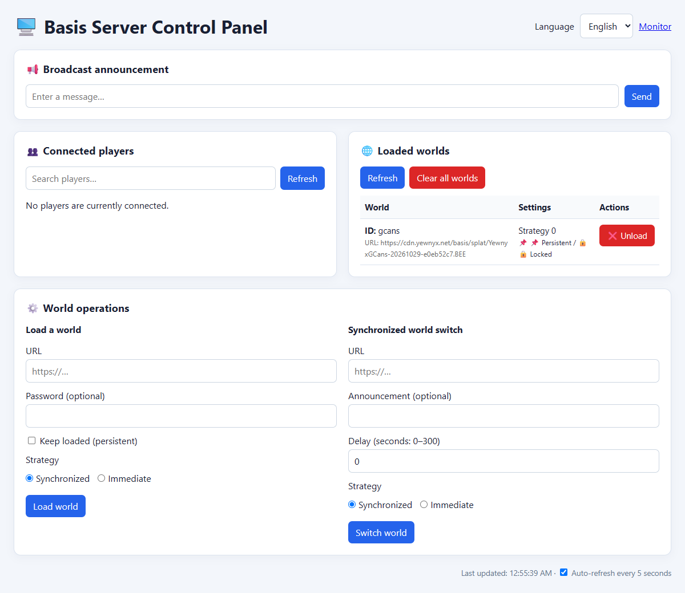

# Tutorial: several Basis worlds on one server

[日本語](tutorial.ja.md)

By the end you'll have several Basis worlds running on one small Linux server. Each has its own
name, and players join by typing just that name:

```
worlds.example.com          →  hub     (UDP 4296)
forest.worlds.example.com   →  Forest  (UDP 4297)
city.worlds.example.com     →  City    (UDP 4298)
```

This works through DNS SRV records ([RFC 2782](https://www.rfc-editor.org/rfc/rfc2782)). When a
player enters a name without a port, the Basis client looks up `_basis._udp.<name>` and connects
to the host and port the record names. Every world shares one IP address and listens on its own
port.

## What you need

- **A Linux server** with Docker and the compose plugin, and a public IPv4 address.
  - The servers are light: an idle world uses about 85 MB of RAM. The smallest VPS from most
    providers is plenty.
  - Building the image once takes about 1.5 GB of RAM and 2 GB of disk. On a 2 GB machine, add swap.
- **A domain** whose DNS you control. Your DNS provider must support SRV records.
- **Your worlds as `.BEE` bundles** on an HTTPS host or CDN, plus the password they were built with.
- **A Basis client new enough for SRV lookups and "Save to server":** built from upstream
  `experimental-branch-major-changes` at commit `41789fb7d` (2026-10-27) or later.
  - Older clients still connect, but to `<name>:4296`, which is always the hub.
  - Web builds can't make DNS queries at all.
- **Your player DID** (`did:key:z6Mk...`) so you can be admin.

## 1. Prepare the server

Open the UDP port of every world in the firewall: 4296 for the first world, then one more per world.
If you'll let web players in (section 9), also open TCP 80, 443, 4296 and every world port.
Open nothing else to the public; reach SSH through a VPN (such as Tailscale) if you can. Install Docker
Engine with the compose plugin.

## 2. Get this repository and describe your worlds

On GitHub, click **Use this template** to make your own copy (it starts with no history), then
clone your copy onto the server:

```sh
git clone https://github.com/<you>/BasisMultiWorld.git basis-worlds
cd basis-worlds
cp .env.example .env && chmod 600 .env
```

Edit `worlds.conf`. Use one line per world: slug, UDP port, bundle, display name. **The first line
is the hub. Keep it on 4296.**

```
hub      4296   Hub.BEE       My Hub
forest   4297   Forest.BEE    Forest Walk
city     4298   City.BEE      City at Night
```

Edit `.env` and fill in at least these four:

| Setting | What it is |
| --- | --- |
| `CDN_BASE` | the URL your bundles are under, no trailing slash (`https://cdn.example.com/basis`) |
| `UNLOCK_PASSWORD` | the password your bundles were built with |
| `BASIS_FIRST_ADMIN` | your DID; comma-separate several |
| `DNS_ZONE` | the name of the hub (`worlds.example.com`); every other world is `<slug>.` in front of it |

`BASIS_REF` pins the upstream Basis commit that the server is built from. The repository doesn't
contain Basis itself: `fetch-basis.sh` downloads only the `Basis Server/` folder of
[BasisVR/Basis](https://github.com/BasisVR/Basis) at that commit, which is about 11 MB.

## 3. Build and start

```sh
./fetch-basis.sh          # upstream server source → ./basis
./configure.sh            # worlds.conf + .env → docker-compose.yml + worlds/<slug>/…/world.xml
sudo docker compose up -d --build
sudo docker compose ps    # every world should become "healthy"
curl -fsS localhost:10666/health   # first world; the next ones are 10667, 10668, …
```

`configure.sh` checks `worlds.conf` first: duplicate slugs or ports, bad port numbers, a missing
password. If anything is wrong, it changes nothing. Re-run it whenever you edit `worlds.conf` or
`.env`, then run `sudo docker compose up -d`.

## 4. DNS

```sh
./dns-records.sh 203.0.113.10 > records.txt   # your server's IPv4
```

This prints the full record set in BIND format: an A record for every name, a wildcard, and one
SRV record per world. Import the file, or type the records in by hand.

- **Cloudflare:** go to DNS → Records → Import and Export → Import. Leave "Proxy imported DNS
  records" **off**. The proxy can't carry the game's UDP traffic, and every record must be "DNS only".
- **Why each world also has its own A record:** the SRV record under a name keeps the wildcard from
  covering that name. Without its own A record, a client whose SRV lookup fails would get no address
  at all, instead of landing in the hub.

Check the records:

```sh
dig +short SRV _basis._udp.forest.worlds.example.com   # → 0 0 4297 vm1.worlds.example.com.
dig +short A forest.worlds.example.com                 # → your IPv4
```

## 5. Join

In the client, connect to `worlds.example.com` with no port. You should land in the hub, as admin.
Then try `forest.worlds.example.com`.



*A hub set up this way, in desktop Chrome. [Open it yourself](https://play.basis.yewnyx.net/?connection=basis.yewnyx.net&name=Guest)
to join as "Guest".*

## 6. Portals between worlds

A portal is a small prop with a door that sends the player to another world.
[`examples/ServerPortal.cs`](../examples/ServerPortal.cs) is a version tested inside props. The
creator guide's `ServerPortal` example fails in a prop. Set the door's `host` to the world's name
and leave `port` at **4296**, so the client does the SRV lookup and DNS decides where the door
leads.

Building the prop:

1. **On the prop's root object:** `BasisProp`, a **`CilboxPropBasis` (on the root itself)** and
   `ServerPortal`.
2. **The door:** a child with a collider on the `Interactable` layer and a `BasisInteractableButton`.
   Set `InteractRange` to about 3; the default 1 m is short on desktop. Assign the door and the two
   TextMeshPro labels in the inspector.
3. **The build:** build from a **saved** scene. Include all the platforms the SDK offers, so every
   player can see the door. In the Unity log, each platform should say "Cilbox scripts to do: 1"; a
   0 there means a dead door.
4. **Publish:** upload the `.BEE` next to your worlds.

Placing it on a server:

1. **Spawn the prop as Networked**, as admin, from the Library.
2. **Move it where you want it.**
3. **In the Instantiated tab, click "Save to server".** The server writes the prop into that world's
   `initialresources/` and loads it again on every restart.

Don't use "Load on Boot": it only loads the item in your own client.

Players press the door, see the destination address and confirm. The prompt always shows
`<name>:4296` even when SRV sends them to another port; that's expected. Basis's built-in "rift"
portals also work, but they disappear when the server restarts.

<p>
  
  
</p>

*Left: aim at the door and it lights up. Right: pressing it asks first. The address shows port 4296
whichever port the world really uses.*

To move saved portals to a new build later, use `repoint-prop.sh` (section 8).

## 7. Optional: admin dashboard

Each world can get a [MarusansiBasisDashboard](https://github.com/nodokaha/MarusansiBasisDashboard),
which shows players and lets you load worlds and send announcements. Turning it on:

1. **Give each world an API key** in `.env` (`HUB_API_KEY=` and so on). Generate each with
   `openssl rand -hex 32`.
2. **Recreate the servers with the API on:** `./configure.sh && sudo docker compose up -d`. This
   restarts the worlds.
3. **Start the dashboards:** `sudo docker compose --profile dashboard up -d --build`.

The dashboards listen on the server's own `127.0.0.1:4000` and up, one per world. **Their admin
pages have no login and accept requests from any website. Never publish those ports.** Reach them
through an SSH tunnel, or over Tailscale with `tailscale serve --bg --http=4000 http://127.0.0.1:4000`
and an access rule limited to your own devices.



*The admin page (`/admin`) of a hub with nobody connected. It follows the browser's language,
English or Japanese, and the Language menu switches it.*

## 8. Running it

- **Admins:** `BASIS_FIRST_ADMIN` only applies on a world's first boot. To add an admin later:
  ```sh
  sudo docker compose stop && sudo ./add-admin.sh did:key:z6Mk... && sudo docker compose up -d
  ```
- **Default library:** avatars and props an admin adds under Admin > Default library in the
  client are offered in every visitor's Library while they're on that world (nobody's avatar is
  changed). Each world keeps its own list as XML files in `worlds/<slug>/defaultlibrary/`. To give
  every world the same list, copy the files across and run `sudo docker compose restart`; the list
  is read at startup.
- **Backups:** everything worth keeping is `.env` plus `worlds/*/config` (admins, permissions),
  `worlds/*/storage` (player saves), `worlds/*/initialresources` (props saved to the server) and
  `worlds/*/defaultlibrary`. It's only kilobytes. Back it up daily (restic works well), and keep it
  on a disk that survives rebuilding the server.
- **Updating Basis:** change `BASIS_REF` in `.env`, then run
  `./fetch-basis.sh && sudo docker compose up -d --build`.
- **Replacing a world bundle:** both your CDN and the Basis client cache by URL. The client never
  checks for a newer file under the same name. Either upload under a new file name and update
  `worlds.conf`, or purge your CDN and accept that players who already loaded the world may keep the
  old copy. For a new file name, `sudo ./deploy-world.sh forest` applies the change. It checks that
  the new file is online and that nobody is in the world, then runs `configure.sh` and restarts that
  world and its dashboard. `--check` only reports.
- **Replacing a saved prop** (a portal, for example): upload the new build under a new file name,
  then run `sudo ./repoint-prop.sh forest PortalToHub.BEE PortalToHub-v2.BEE` in each world that
  saved it. It makes the same checks, copies the saved files to `worlds/<slug>/prop-backup-<time>/`,
  and edits them while the world is stopped. The saved files contain the unlock password, so the
  script never prints them. Delete the backup folder once the world works.

## 9. Optional: web players

Basis also runs in a browser. Browsers can't send UDP, so web players connect over WebSocket, and a
page served over `https://` may only open `wss://`. With this turned on:

- **Every world also listens on WebSocket** through the
  [Basis-TCP-Transport-Package](https://github.com/dooly123/Basis-TCP-Transport-Package), which
  `fetch-basis.sh` builds into the server. That listener is internal.
- **A [Caddy](https://caddyserver.com) container is the public side.** It gets Let's Encrypt
  certificates for your world names and sends each name to its world. A browser can't look up SRV
  records, so the web client turns a plain name into `wss://<name>:4296/`. Caddy answers on 4296 (and
  443) and routes by name, so typing a world's name or walking through a portal works the same in a
  browser. On the other world ports it routes by port, like UDP.
- **Native clients can use it too:** `wss://forest.worlds.example.com` works on networks that block UDP.

Turning it on:

1. **In `.env`,** set `WEB_PLAYERS=yes` (`DNS_ZONE` must be your real domain). Optionally set
   `WEB_CLIENT_URL` to where you host the web client (step 4). Then opening
   `https://forest.worlds.example.com` in a browser redirects to the client, set to join that world.
2. **Open TCP** 80, 443, 4296 and every world port in the firewall. Port 80 is for the certificates.
3. **Apply it.** `./configure.sh && sudo docker compose down && sudo docker compose up -d`. The `down`
   is needed once, because the compose network gets a fixed subnet that the worlds trust for players'
   real addresses. Check the certificates with
   `sudo docker compose logs caddy | grep "certificate obtained"`. Caddy reads its file only when it
   starts, so whenever you run `configure.sh` again later, also reload it:
   `sudo docker compose exec -w /etc/caddy caddy caddy reload`.
4. **Host the web client.** Upstream CI builds one for every commit: download the `Basis-Client-WebGL`
   artifact of the `compilation.yml` run for your `BASIS_REF`, for example
   `gh run download <run-id> -R BasisVR/Basis -n Basis-Client-WebGL -D web`. Artifacts expire after
   about 90 days, so keep a copy.
   - **Serve it from a CDN or static host under its own `https://` name,** such as
     `play.worlds.example.com`, not from the Basis server. It's about 120 MB, and a game server's
     bandwidth to distant players can be poor.
   - **Keep players on one address.** The browser stores the client's settings and its cached worlds
     per page folder, so a new address starts players from scratch. To update the client without
     changing it, see the next section.
   - **Headers it needs:** `Content-Encoding: br` on `*.unityweb`, and `Content-Type: application/wasm`
     on `*.wasm.unityweb`. On Bunny, set these with edge rules on a Request URL condition; Bunny's File
     Extension condition only sees the last extension. COOP/COEP aren't needed (the build has no threads).
5. **Allow CORS where your bundles are hosted.** The web client fetches `.BEE` files from another site:
   - `Access-Control-Allow-Origin: *` (fine for public bundles)
   - `Access-Control-Allow-Headers: Range, If-None-Match, If-Modified-Since`
   - `Access-Control-Expose-Headers: Content-Range, ETag`

   The browser's `OPTIONS` preflight must get a 2xx answer, not 405. Set these in exactly one place: two
   `Access-Control-Allow-Origin` headers (for example from a CDN and a proxy in front of it) break CORS.
6. **Build your worlds and props for the web.** Include the WebGL platform in the SDK. A bundle without
   a WebGL section can't load in a browser.

Upstream's web client needs WebGPU and 64-bit WebAssembly: desktop Chrome, Edge or Firefox (Firefox
was tested on Windows). For iPhone and iPad, see "A 32-bit build for iPhone and iPad" below. Players
join with
`https://play.worlds.example.com/?connection=forest.worlds.example.com`, or just open the world's name
if `WEB_CLIENT_URL` is set. For a live example, open
[play.basis.yewnyx.net](https://play.basis.yewnyx.net/?connection=basis.yewnyx.net&name=Guest), which
joins its hub as "Guest".

### Updating the web client without breaking it

These traps were all found on a live deployment:

- **Put each client build in its own folder, and never overwrite one,** for example `/basis-2f5b3e1/`.
  Browsers and CDNs keep the large files for a long time, and a CDN's storage copies can serve the old
  file for a while after an overwrite. Keep the previous folder for rolling back.
- **Have one page at the root load the current folder.** Copy the build's `index.html` and
  `TemplateData/` to the root, and change two paths in the page: `var buildUrl = "Build"` becomes
  `"/basis-2f5b3e1/Build"`, and `streamingAssetsUrl: "StreamingAssets"` becomes
  `"/basis-2f5b3e1/StreamingAssets"`. An update then changes only those two paths, and players keep
  their settings and cached worlds. A page inside each build folder would start them from scratch every
  time. The same page can also choose between two builds (see the next section).
- **Don't let browsers cache that page.** Serve `index.html` and the bare `/` with
  `Cache-Control: no-cache`, so browsers check for a new copy on every visit. The build folders can keep
  long cache times. After replacing the page, purge it on the CDN: Bunny caches `/` and `/index.html`
  separately, so purge both. On Bunny, an edge rule with the Request URL conditions `*/` and `*.html`
  can set the header. In Bunny's patterns `?` matches any one character, so a pattern like `*/?*`
  matches every file.
- **Link to the root page, not into build folders.** If you do open a folder's own page, include the
  trailing slash. Some hosts, Bunny among them, answer `/basis-2f5b3e1` without the slash with that
  folder's page. Its relative `Build/` then points at the parent folder, which loads the wrong build or
  none.

### A 32-bit build for iPhone and iPad

Upstream CI only builds 64-bit WebAssembly, which lets the client use up to 16 GB. WebKit has no
Memory64 yet, and every browser on iPhone and iPad is WebKit, as is Safari on the Mac. A 32-bit build,
limited to 4 GB, does start there; the live deployment above gives one to phones and tablets. Build it
yourself from your `BASIS_REF`, with the Unity version the project names (6000.7.0b6 at `2f5b3e106`):

1. **Add the WebSocket package** to `Basis/Packages/manifest.json` (CI adds it only for its web job):
   `"com.basis.transport.websocket": "https://github.com/dooly123/Basis-TCP-Transport-Package.git#<WEBSOCKET_REF>",`
2. **Make it 32-bit:** in `Basis/Packages/com.basis.framework.editor/Editor/BasisWebBuild.cs`, set
   `Wasm64MaximumMemoryMegabytes` to `4096`. With a maximum of 4 GB, Unity builds 32-bit WebAssembly.
3. **Consider reserving memory at startup:** in the same file, next to `maximumMemorySize`, add
   `PlayerSettings.WebGL.initialMemorySize = 1024;`. Growing the heap while a world loads is a likely
   cause of the tab crashes we saw on an iPhone.
4. **Build:** `Unity -batchmode -nographics -quit -projectPath Basis -buildTarget WebGL -executeMethod BasisWebBuild.BuildWeb -customBuildPath <output folder>`

Put it in its own folder beside the 64-bit build, and let the root page choose. The live deployment
gives the 64-bit build only to desktop browsers with Memory64, and the 32-bit build to everything
else, phones included:

```js
var memory64 = false;   // the same check Unity's 64-bit loader makes
try { memory64 = WebAssembly.validate(new Uint8Array([0,97,115,109,1,0,0,0,5,8,1,5,128,128,4,128,128,16,7,7,1,3,109,101,109,2,0])); } catch (e) {}
var mobile = /iPhone|iPad|iPod|Android/i.test(navigator.userAgent) ||
  (/Macintosh/.test(navigator.userAgent) && navigator.maxTouchPoints > 1);   // iPadOS reports a Mac
var folder = memory64 && !mobile ? "/basis-2f5b3e1/" : "/basis-2f5b3e1-wasm32/";
var buildUrl = folder + "Build";   // and streamingAssetsUrl: folder + "StreamingAssets"
```

What we saw on an iPhone 17 Pro (Safari 26) with such a build:

- **An "EncodingError: Decoding failed" alert at startup.** One very short sound encodes for the web
  as an empty AAC file, and WebKit refuses to decode it; Unity's loader turns that into an alert. Add
  this near the top of the page, before the loader starts. The sound just stays silent.
  ```html
  <script>
    ["unhandledrejection", "error"].forEach(function (type) {
      window.addEventListener(type, function (e) {
        var r = e.reason || e.error;
        if (r && (r.name === "EncodingError" || /Decoding failed/.test(String(r)))) { e.preventDefault(); e.stopImmediatePropagation(); }
      });
    });
  </script>
  ```
- **Portal doors can't be tapped.** Upstream's touch input never presses buttons in the world; menus
  and the on-screen sticks work. The live deployment's phone build carries a small local fix for this.
- **Memory is tight.** The client alone uses about 775 MB. Worlds that add little to that loaded fine,
  and one that needed about 900 MB in all crashed the tab. Keep web sections light.
- **Textures:** BC-compressed textures need an iPhone 15 Pro or later, or an M-series iPad. ASTC works
  on all of them.
- **Shaders:** Safari enforces WebGPU's limit of 8,192 bytes of variables in a shader function, and
  desktop Chrome doesn't. A large constant array inside a function fails only on Apple devices.
- Android phones and Safari on the Mac weren't tested.

## Troubleshooting

| Symptom | Cause |
| --- | --- |
| Every world name and every portal lands in the hub | The client is older than 2026-10-27 and does no SRV lookup, or the SRV records are missing. Check with `dig`. |
| A world never becomes healthy | `sudo docker compose logs --tail=50 <slug>`. |
| `curl localhost:1066x/health` returns 404 or no answer | Run `configure.sh` again: the generated file sets `HealthCheckHost: "*"`. The default `localhost` doesn't work in containers. |
| "Save to server" fails | `initialresources` must be writable. The stock upstream compose file mounts it read-only. |
| Players can't connect at all | The UDP port isn't open in the firewall, or Cloudflare's proxy is on for the record. |
| Web: "Set a username before joining a server" on the first visit | A known upstream issue: a `?connection=` link connects before the player has a name. Set a name and join once from the Servers menu; the browser remembers it. Adding `&name=Guest` to links also avoids it. |
| Web: "Your browser does not support WebAssembly Memory64" | The browser got upstream's 64-bit build. WebKit can't run it yet: every browser on iPhone and iPad, and Safari on the Mac. Use desktop Chrome, Edge or Firefox, or also host a 32-bit build (see "A 32-bit build for iPhone and iPad"). |
| Web: connected, but the world never appears | The bundle has no WebGL section, or its host doesn't allow CORS (check the browser console). |
| Web: players still get the old client after an update | The entry page was cached. Serve it with `Cache-Control: no-cache` and purge it on the CDN (see "Updating the web client without breaking it"). |
| Web: a build folder's address without the final `/` loads the wrong build | The host serves the folder's page there, and its relative paths point at the parent folder. Link with the slash, or to the root page. |
| A new build of a world or prop doesn't reach some players | It was uploaded under the same name, and the client and the CDN cache by URL. Upload it under a new name and switch with `deploy-world.sh` or `repoint-prop.sh`. |
| Caddy gets no certificate | TCP 80 or 443 is closed, or the name doesn't point at this server. Only names from `worlds.conf` get certificates. |

## How the SRV lookup behaves

- **When it happens:** with no port, or with the default 4296, the client looks up
  `_basis._udp.<name>` and connects to the record's target and port. Any other port connects
  directly, with no lookup.
- **Several records:** lower priority wins, and records with equal priority share players by weight.
  The client tries up to three targets.
- **No record:** the client connects to `<name>:4296`. With the wildcard A record, an unknown or
  failed name ends up in the hub.
- **Caching:** answers are cached for the record's TTL, at most 5 minutes.
- **Web clients:** a browser can't send DNS packets, so the lookup fails quietly and the client
  connects to `<name>:4296`. With web players on, Caddy's routing by name stands in for SRV.

## Credits

- [Basis](https://github.com/BasisVR/Basis) by BasisVR (MIT). This repository only builds its server.
- [MarusansiBasisDashboard](https://github.com/nodokaha/MarusansiBasisDashboard) by nodokaha.
- [Basis-TCP-Transport-Package](https://github.com/dooly123/Basis-TCP-Transport-Package) by dooly123,
  the WebSocket transport.
- [Caddy](https://caddyserver.com), for TLS in front of web players.
- [basispm-build-awesome](https://github.com/nodokaha/basispm-build-awesome) by nodokaha, for the
  "build the server straight from upstream" idea.
- The prop-safe portal script was tested by the Splat project's Basis tooling.
